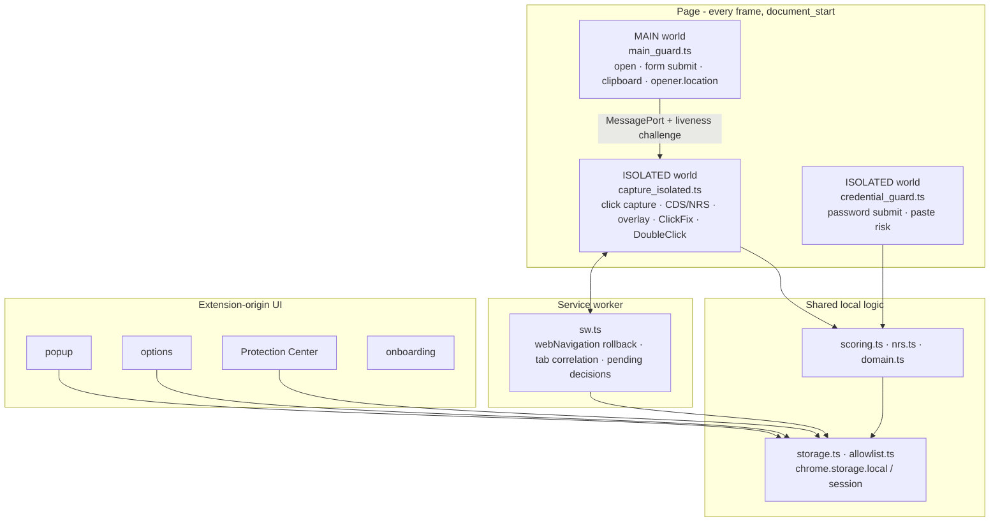

# Heedline

<p align="center"></p>

Local-first Chrome MV3 interaction guard: it checks deceptive navigation and risky browser actions, explains why it intervened, and makes no runtime network calls.

> **Pre-alpha.** Not efficacy-validated, independently audited, or in the Chrome Web Store. The product was renamed from NavSentinel to Heedline on 2026-09-27; formal trademark clearance is still pending before any store submission (AI-19). The GitHub repository stays `NavSentinel` on purpose so existing installs keep their data. Use a repository build for development and dogfooding, not as a sole security control.

[](https://github.com/Chris0Jeky/NavSentinel/actions/workflows/ci.yml)
[](LICENSE)
[](https://github.com/Chris0Jeky/NavSentinel/releases)
[](extension/manifest.json)
[](package.json)
[](package.json)

[Product strategy](docs/Product_Strategy.md) ·
[Architecture](docs/Architecture_and_Data_Flow.md) ·
[Testing and Gym](docs/Testing_and_Gym.md) ·
[Privacy](PRIVACY.md) ·
[Security](SECURITY.md) ·
[Contributing](CONTRIBUTING.md)

## What it is

Heedline sits on the interaction, not on a URL list. When a page turns a click, overlay, form, popup, or clipboard write into a consequential side effect, the extension scores that moment locally, then allows, prompts, blocks, or rolls back.

The current default build is **interaction-only**: no reputation service, no remote telemetry, no password-value storage, and no runtime network lookup. Bundled assets loaded with `chrome.runtime.getURL(...)` stay local. A separate unpacked-only `research-reputation` profile exists for deterministic reserved-domain experiments; packaging and release checks reject it.

The interesting part is not a longer heuristic list. It is inspectable decisions plus a Gym that can replay the attack and the benign contrast against the same build.

## Why it exists

Browser Safe Browsing, TLS, and password managers already cover a lot. They do not sit on the gesture itself: the overlay that stole the click, the form action that moved after you typed, the second click that landed on a different control, the fake CAPTCHA that wrote a command to the clipboard.

I build local-first tools. This one is the check I wanted at that boundary — with a reason code, a bounded local log, and no cloud scoring.

## What the current build does

Implemented on `main` is not the same as proven on the open web. These are the real surfaces:

- **Deceptive navigation.** Hidden overlays, click retargeting, popunders, delayed redirects, synthetic popup attempts, suspicious `_blank` behaviour, and selected cross-domain rollback. Scoring is the Click Deception Score (CDS) plus a Navigation Risk Score (NRS).
- **Foreground overlay suppression.** Optional. Classifier-identified high-severity layers, including qualifying child-frame cases, are hidden with one grouped Undo and no synthetic click replay.
- **Programmatic navigation.** Main-world interception of `window.open` and form `submit` / `requestSubmit`. Chromium will not let an extension replace `location.assign` or `location.replace`; those are `[LegacyUnforgeable]`. The service worker may roll a **top-frame** commit back afterwards, under documented conditions — post-commit recovery, not a pre-navigation intercept.
- **Credential submissions.** Local risk checks for insecure password posts, untrusted or lookalike destinations, suspicious cross-site actions, and selected paste-into-password risks. Trusted domains are registrable domains the user is willing to submit credentials to, not a generic “good site” list.
- **DoubleClickjacking.** Correlation across the main world, isolated world, and service worker for attacks that move a sensitive control under the second click (`window.opener.location` plus child-tab timing).
- **ClickFix / fake CAPTCHA.** Page-level correlation of clipboard writes, overlay presence, and “paste this command” instruction text. Clipboard bytes are inspected transiently in the page’s main world to derive metadata; they are not bridged, stored, or transmitted.
- **OAuth / redirect context.** Local monitoring of likely OAuth popup and redirect behaviour, plus NRS modifiers from redirect-chain shape, CSP, and SRI. This does not validate app identity or requested scopes.
- **Operator surfaces.** Popup, options, first-install onboarding, Protection Center (bounded local journal), trusted-domain management, navigation allowlists, import/export, and prompt outcomes.
- **Build-profile receipts.** `npm run build` emits an `interaction-only` receipt. Packaging refuses a non-release profile.

JavaScript-behaviour instrumentation (`fetch` / XHR / `sendBeacon` wrappers) is **off** in every committed profile, including the default. Do not describe it as shipped protection.

## Architecture

Four runtime surfaces, wired from `extension/manifest.json`. The three content scripts run in all frames at `document_start`; the service worker and the extension-origin UI do not:



The main/isolated bridge transfers a `MessagePort`, then runs a challenge-response that proves possession of that port. It does **not** authenticate an isolated-world identity against hostile same-page code. `document_start` ordering is a mitigation. Issues #175 and #186 remain beta gates.

Steady-state traffic is type-allowlisted and session-scoped. Page-injected toasts can warn or dismiss; protection-lowering proceed / allow / trust / resume belongs on extension-origin UI bound to the intended tab, destination, and one-use authority. That boundary is still open (RI-01). One suspicious `_blank` “Proceed once” path already lives in the popup; other classes do not.

The Gym (`gym/`) and Evidence Observatory (`experiments/evidence-observatory/`) are development infrastructure. They have no authority to click, submit, install, package, or change protection settings.

## Modes

### Navigation

| Mode | Role |
| --- | --- |
| `Off` | No intervention. Useful for controlled comparisons. |
| `Smart` | Intended default. Blocks clear deception; allows ordinary navigation and most legitimate new-tab flows. |
| `Strict` | Lower threshold for Gym and adversarial development. |

### Credential protection

| Mode | Role |
| --- | --- |
| `Off` | No password-submit prompting or paste warnings. |
| `Smart` | Prompt on untrusted destinations and medium/high-risk submissions. |
| `Strict` | More aggressive phishing-style test posture. |

Trusted domains and the navigation allowlist are separate controls. Trusting a site to receive credentials is not the same as permitting one destination from one source after a navigation prompt.

## Quickstart

Requires Node `^20.19.0 || ^22.13.0 || >=24`. CI pins Node 20.

```bash
npm install
npm run build
```

`npm run build` selects the release-eligible `interaction-only` profile and writes `extension/dist`.

1. Open `chrome://extensions`.
2. Enable Developer Mode.
3. Load unpacked → select `extension/dist`.

After every rebuild, click **Reload** on Heedline *before* reloading an open test page. Reloading only the page can keep an old hashed content-script loader alive. Loading or reloading the unpacked extension is a human-owned step; agents build `extension/dist` and stop there.

Watch mode:

```bash
npm run watch
```

Deterministic Gym (Vite, port 5173):

```bash
npm run gym:serve
```

Then open the served index. It covers navigation levels, real-world and stress scenarios, ClickFix, DoubleClickjacking, redirect chains, content fingerprinting, DOM mutation, pushState abuse, OAuth fixtures, evasion composites, CSP/SRI, history traversal, URL userinfo models, and contained identity URL models. Fixtures are local and inert; ClickFix pages use a sentinel clipboard value, not a runnable command.

The following is local research only and produces a **non-release** artifact:

```bash
npm run build:research-reputation
```

## Commands

| Command | What it actually runs |
| --- | --- |
| `npm run typecheck` | `tsc -p tsconfig.json --noEmit` |
| `npm run lint` | ESLint over `extension/src`, `tests`, `scripts`, `gym` |
| `npm test` | Vitest unit suite |
| `npm run test:e2e` | Playwright smoke + regression + phase2 (needs `extension/dist`) |
| `npm run test:e2e:rollback` | Rollback lane (`playwright.rollback.config.ts`) |
| `npm run test:e2e:branded` | Current branded Chrome (`playwright.branded.config.ts`) |
| `npm run test:acceptance` | Owner-browser acceptance evidence, not a Gate-3 result |
| `npm run verify:versions` | Aligns `package.json`, `extension/manifest.json`, lockfile |
| `npm run package:ext` | MV3 worker + content-loader checks, then zip |
| `npm run check:release-profile -- --release` | Interaction-only receipt; rejects research bits |
| `npm run demo:showcase` | Guided local demo (`scripts/run_demo.mjs core`) |
| `npm run demo:showcase:record` | Same, with recording |
| `npm run security:check` | Adversarial-programme registry/views |

There is no hosted live demo. `demo:showcase` drives a local Playwright session against the Gym.

## Tech stack

| Layer | Choice | Source |
| --- | --- | --- |
| Extension | Chrome Manifest V3, `all_frames`, `document_start` | `extension/manifest.json` |
| Language | TypeScript `^5.6.0` | `package.json` |
| Bundler | Vite `^8.2.2` + `@crxjs/vite-plugin` | `vite.config.ts` |
| Unit tests | Vitest `^4` + happy-dom | `vitest.config.ts` |
| Browser tests | Playwright `^1.49` (Chromium; branded Chrome optional) | `playwright.config.ts` |
| UI | Extension pages in TypeScript + CSS tokens; no React runtime | `extension/src/popup`, `options`, `evidence`, `onboarding` |
| Permissions | `storage`, `webNavigation`, `tabs`, host `<all_urls>` | `extension/manifest.json` |
| License | GNU GPLv3 | `LICENSE` |
| Runtime Node | engines: `^20.19.0` or `^22.13.0` or `>=24` | `package.json` |

Internal identifiers keep the former name on purpose: storage keys, DOM ids, `data-navsentinel-*` markers, export format identifiers, the `[NavSentinel]` console prefix, `NAVSENTINEL_*` environment variables, and this repository name.

## Evidence-first development

Two cooperating planes with different authority:

1. **The Guard** — the MV3 extension, local policies, decision engine, operator UI, bounded logs, and release profile.
2. **The Evidence system** — deterministic Gym fixtures, adversarial campaigns, recorded scenes, reason codes, proof receipts, and release-input attestations.

The evidence system is not telemetry and must not gain authority to click, submit, install, package, release, or change protection settings. Its job is to make a claim reproducible: page state, user action, mutations, which rule fired, which build/profile produced the result, and what remains untested.

Current Observatory and campaign work lives under `experiments/` and `docs/security-program/`. That is development infrastructure, not a public monitoring product and not evidence that the extension is ready for broad use.

## Status and roadmap

Version **0.5.0** (manifest and `package.json`). A GitHub **pre-release** tag `v0.5.0` exists (2026-09-26). There is no Chrome Web Store listing.

Outcome gates, from [`docs/Project_Roadmap.md`](docs/Project_Roadmap.md) and live GitHub milestones:

| Gate / milestone | State |
| --- | --- |
| Release profile (interaction-only) | Implemented |
| Release integrity (RI-01 authority, bridge #175/#186, consent, package identity) | Blocked |
| Brand / store (AI-19 name clearance, #455 disclosure) | Blocked |
| Detection validation and comparative value | Open |
| `M0-proving-ground-foundation` | Active — hermetic browser evidence |
| `v0.5.0-unlisted-beta` | Active — interaction-only unlisted beta integrity |
| `v0.5.1-interaction-integrity` | Planned |
| `v0.6.0-local-evidence-plane` | Planned |
| `EV-1-efficacy-and-quietness` | Planned |
| `BETA-1-cohort-and-operations` | Gated on M1 |
| `post-beta-horizon` | Frozen |

Narrow product path:

1. Close the remaining authority and release-integrity blockers.
2. Package one understandable interaction-only beta.
3. Recruit a small real-user cohort (roadmap target: 15 invitations, 10 activated daily-use installs).
4. Measure additive protection, interruption, comprehension, and retention — not “number of blocks”.
5. Fix the evidence-backed problems before adding reputation services, cloud dashboards, or a commercial layer.

GitHub issues own implementation detail. [`ACTION_ITEMS.md`](ACTION_ITEMS.md) owns human-only checks. Resume that queue at **AI-19**.

## Not currently claimed

Heedline does **not** currently claim:

- measured efficacy or a reduction in real-world compromise;
- complete coverage of browser navigation, frames, forms, or extension races;
- a released Chrome Web Store package;
- Firefox support. Chromium is the only supported and tested target: the build packages `extension/manifest.json` only, and CI installs only Chromium. `extension/manifest.firefox.json` is an unbuilt draft for the frozen Firefox port (roadmap P4-03), and Gecko behaviour such as the credential guard's `formdata`-time resubmit binding is unmeasured ([#1101](https://github.com/Chris0Jeky/NavSentinel/issues/1101));
- external security audit or independent validation;
- a reputation service, cloud dashboard, enterprise policy plane, or automatic remediation;
- that a blocked event was necessarily malicious, or that an allowed event was safe.

Those are evidence questions, not marketing defaults. CONTRIBUTING’s verified-claims policy: no user-facing protection claim ships without a committed measurement artifact or a CI-verified fixture behind it.

## Privacy and security

- no remote telemetry in the current product build;
- no reputation lookup in the interaction-only profile;
- no runtime network lookup in the research reputation profile either;
- no password-value storage;
- clipboard content is inspected transiently in the page’s main world only to derive ClickFix metadata;
- persistent configuration, bounded event history, and prompt outcomes stay in `chrome.storage.local`; short-lived pending decisions and per-tab security state use `chrome.storage.session` and clear when the browser closes;
- the MessagePort challenge proves possession/liveness, not a hard authenticated identity boundary;
- local history, export, deletion, and retention limitations are documented rather than implied away.

The development build starts content scripts at `document_start` before an affirmative activation gate exists. #455 / PM-03 blocks beta until listing disclosure, install consent, and in-product activation are real.

Read [PRIVACY.md](PRIVACY.md), [SECURITY.md](SECURITY.md), and the [threat model](docs/Threat_Model_and_Cases.md) before treating any local build as protection.

If a bug could materially weaken the protections, use the [private vulnerability report](https://github.com/Chris0Jeky/NavSentinel/security/advisories/new) instead of a public issue.

## Repository map

- `extension/` — MV3 source, manifest, assets, and build output (`extension/dist/` is generated; do not edit it)
- `gym/` — deterministic attack, benign, and edge-case fixtures
- `tests/` — Vitest logic tests and Playwright E2E
- `docs/` — architecture, threat model, strategy, evidence, testing, release, and roadmap
- `scripts/` — profile/build checks, packaging, research fixtures, benchmarks
- `autodoc/` — agent-facing code orientation
- `experiments/` — Evidence Observatory, Vision Lab; not shipped protection
- `config/release-profiles.json` — `interaction-only` (release) vs `research-reputation` (unpacked-only)

Start with [docs/README.md](docs/README.md), then:

- [Project overview](docs/Project_Overview.md)
- [Product strategy](docs/Product_Strategy.md)
- [Architecture and data flow](docs/Architecture_and_Data_Flow.md)
- [Intent model and scoring](docs/Intent_Model_and_Scoring.md)
- [Testing and Gym](docs/Testing_and_Gym.md)
- [Real-world adversarial programme](docs/Real_World_Adversarial_Program.md)
- [Security programme](docs/security-program/README.md)
- [Release process](docs/RELEASING.md)

## Contributing

This is a browser-extension repo with deterministic local fixtures. Keep a Gym page, a focused test, and a small code change aligned. Tracked text files must materialize LF bytes.

See [CONTRIBUTING.md](CONTRIBUTING.md) for environment, the verified-claims policy, and where to change navigation, credentials, storage, UI, or the service worker. Keep those seams separate unless the behaviour actually crosses them.

```bash
npm run typecheck
npm run lint
npm test
```

Human Gate-3 (real Chrome reload of the unpacked build) applies only when a change alters shipped browser behaviour. Docs-only work does not.

## Links

- [Documentation index](docs/README.md)
- [Changelog](CHANGELOG.md)
- [GitHub releases](https://github.com/Chris0Jeky/NavSentinel/releases) — `v0.5.0` is a pre-release zip, not a store package
- [CI](https://github.com/Chris0Jeky/NavSentinel/actions/workflows/ci.yml)
- [Security policy](SECURITY.md)
- [Privacy](PRIVACY.md)
- [License](LICENSE)

## License

[GNU General Public License v3.0](LICENSE).
